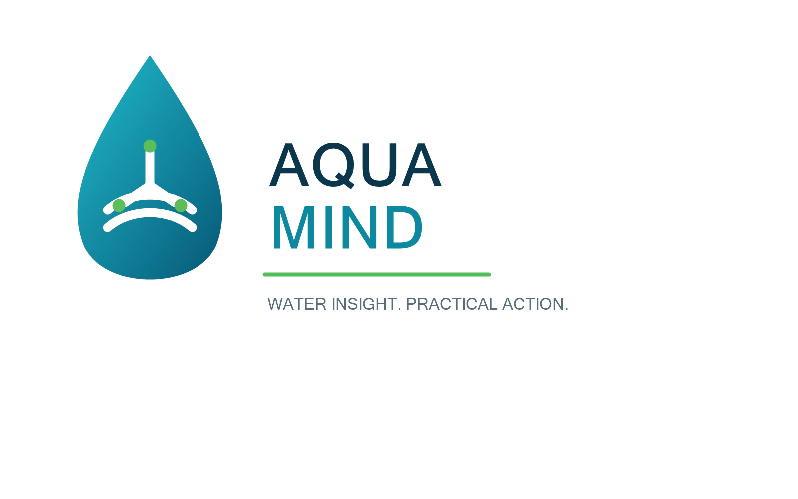
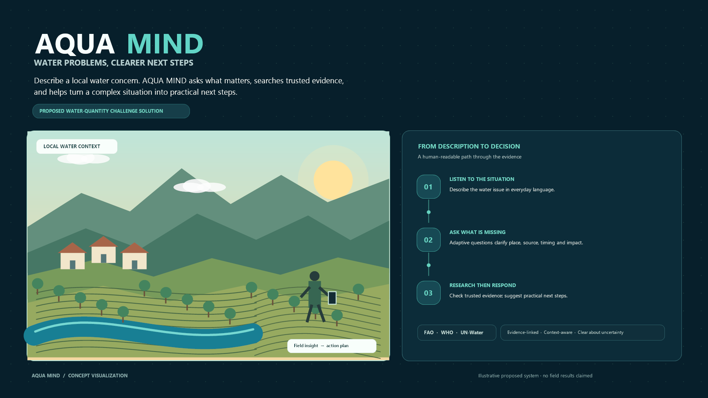

<div align="center">
  
  <h1>AQUA MIND</h1>
  <p><strong>Water insight. Practical action.</strong></p>
  <p>A multilingual assistant for understanding local water problems and finding evidence-linked next steps.</p>
</div>

<p align="center">
  
</p>

## The idea

Water problems rarely have one obvious cause. A supply interruption, a falling well level, or an irrigation issue can look similar while needing very different responses.

**AQUA MIND** is a proposed AI-powered web assistant that helps people investigate those situations. A user describes what is happening; the assistant asks focused follow-up questions, searches relevant research and institutional sources, explains plausible causes, and suggests practical next steps in language suited to the user.

The system is designed to make evidence and uncertainty visible. It supports early investigation; it does not replace water testing, local authorities, or qualified professionals.

## How it works

1. **Describe** — The user explains the water concern in everyday language and can share a broad area and context.
2. **Clarify** — The assistant asks focused follow-up questions about source, timing, impact, and constraints.
3. **Explore** — It reviews relevant evidence, separates possibilities from confirmed details, and presents practical next steps with sources.

## What is included

- `server.mjs` — lightweight Node.js server and research/AI endpoints.
- `index.html`, `styles.css`, `app.js` — responsive Arabic/English web experience.
- `logo.png` and `AQUA_MIND_Logo.png` — project branding.
- `AQUA_MIND_Concept_Illustration.png` — overview of the proposed user journey.
- `AQUA_MIND_Research_Analysis.png` — proposed evaluation protocol; no results are fabricated.

## Run locally

Requirements: Node.js 20 or later. The project has no package dependencies.

```powershell
node server.mjs
```

Open [http://localhost:4173](http://localhost:4173), or run `Run AQUA MIND.bat` on Windows.

## Deploy a public demo

The repository includes `render.yaml` for a free Render web service. In Render, create a **Blueprint** from this repository and apply the `aqua-mind` service. The free service may sleep after 15 minutes without traffic; its first request after that can take about a minute to wake up.

To enable generated AI questions and web research, add `OPENAI_API_KEY` in the service's **Environment** settings. Never put the key in this repository or browser code. OpenAI API usage may incur charges on the key owner's account. Without a key, the guided prototype and OpenAlex literature search remain available.

When a user requests an assessment, their description and answers go to the AQUA MIND server; with AI enabled, they are also sent to OpenAI. The optional broad area may be used in an OpenAlex search. The form warns users not to enter names or exact addresses. The server applies a basic per-address request limit; this prototype is not hardened for high-traffic production use.

### Research and AI modes

- Without an API key, the prototype uses guided follow-up questions and attempts to retrieve related academic records from OpenAlex. If research retrieval is unavailable, the interface says so.
- To enable AI-generated questions and live web research, set `OPENAI_API_KEY` in the server environment before starting. The key stays on the server; never add it to browser code or commit it.
- Assessments are preliminary, not verified diagnoses. Water-quality and health concerns require appropriate local testing and authority guidance.

```powershell
$env:OPENAI_API_KEY="your-key"
node .\server.mjs
```

## Evaluation plan

The next research stage is to test AQUA MIND against matched water-problem scenarios and review its outputs with qualified reviewers. Evaluation should measure source traceability, cause relevance, action feasibility, user understanding, and unsafe or overconfident advice. A future field pilot could compare water use under baseline and assistant-supported decisions, while recording soil, crop, weather, and timing context.

**No field experiment or water-saving result is claimed here.** The analysis graphic is a proposed protocol and reporting framework.

## Project status

This is an early prototype for the Xylem Global Student Innovation Challenge. The web flow and visual materials are present; AI mode requires the deployer's API key, and real-world effectiveness still needs evaluation.

## بالعربي

**AQUA MIND** مساعد ويب مقترح لفهم مشكلات المياه. المستخدم بيشرح المشكلة، والمساعد بيسأله عن التفاصيل الناقصة، ويدور على مصادر موثوقة، وبعدها يعرض أسبابًا محتملة وخطوات عملية مع توضيح حدود المعلومات. النسخة الحالية نموذج أولي؛ صورة التحليل بتعرض خطة تجربة مقترحة فقط، ومفيش نتائج ميدانية فعلية مُعلنة.
